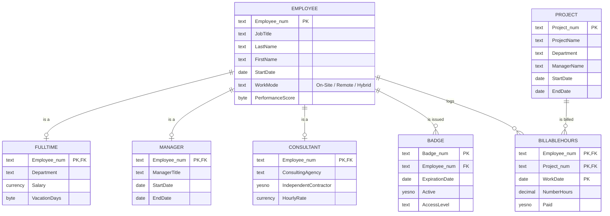
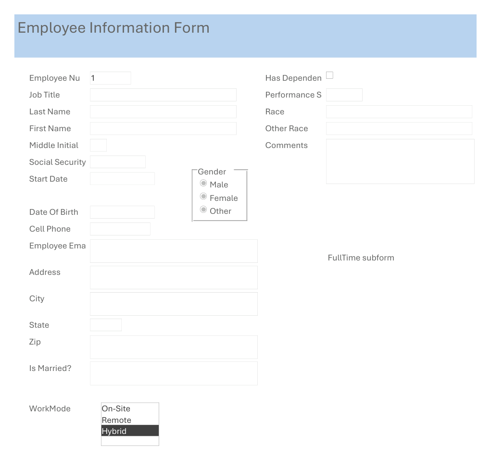

# Consulting Firm Employee Database (Microsoft Access)

A relational database I designed for a consulting firm's employee records. It covers the employee master record, three employment types, security badges, projects and billable hours. Data entry happens through linked forms rather than raw tables.

**Tools:** Microsoft Access · relational design (supertype/subtype, composite keys) · Access forms and subforms

## Design

7 tables. Every relationship enforces referential integrity.

- **Supertype/subtype.** `Employee` holds data shared by every employee. `FullTime`, `Manager` and `Consultant` each link to it **one-to-one** on `Employee#` and store only the fields specific to that role. Salary and vacation days stay off consultant records, and hourly rate stays off full-time records.
- **Many-to-many with a bridge table.** `BillableHours` links `Employee` and `Project`. Its **composite primary key** (`Employee#`, `Project#`, `WorkDate`) allows one entry per employee, per project, per day.
- **Badges** are a separate one-to-many table, so an employee can have replacement badges, each with an expiration date, active flag and access level.

*The `Employee` box shows key fields only. The full table also stores contact details, date of birth, SSN, demographics and comments, 22 fields in all.*

## Forms

| Form | Purpose |
|---|---|
| **Employee Information Form** | Main record, with **FullTime**, **Manager** and **Consultant subforms** embedded and linked on `Employee#`. Uses an option group for gender, a list box for work mode and a combo box for race |
| **Project Information Form** | Projects, with a department drop-down |
| **Billable Hours** | Time entry per employee, project and date, with a paid check box |
| **Badge Form** | Badge issue, expiration, active status and access-level drop-down |

## How to run

You need Microsoft Access on Windows. The `.accdb` file isn't included. See the screenshot and the diagram above.

## Context

Built for **ISBA 3710 Database Management** at Loyola Marymount University (Spring 2026).
